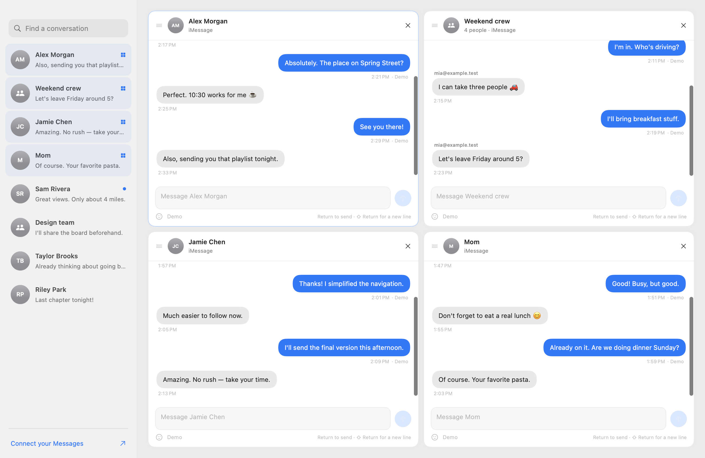

# Mosaic

Several Messages conversations, side by side, in one native macOS window.



Mosaic reads the conversations already on your Mac and keeps up to four of them open as tiles, each with its own history, draft and composer. Replies go out through Messages. Nothing leaves your Mac.

## Features

- **Tiles**: Grid, Columns or Focus layout. Drag a tile's header to rearrange tiles, and drag the gaps between them to resize. Tiles, layout and drafts come back on relaunch.
- **Drafts**: closing a tile keeps its unsent text, recipients and files, and they are listed under **Drafts** in the sidebar.
- **Find**: ⌘F finds a conversation, and ⌥⌘F searches the whole history of the focused one.
- **Details**: ⌘I lists the people in a conversation and its photos, videos, files and links.
- **Unread and notifications**: Mosaic keeps its own unread counts. Messages is never told, and no read receipts are sent. Notifications are optional, and conversations can be muted.
- **Pins and protected tiles**: pin conversations to the top of the sidebar, and protect a tile so it is never replaced.
- **Rich threads**: shows photos, videos, files, link previews, reactions, replies and edits. You can paste, drop or pick pictures and files from Photos.
- **Zoom**: ⌘+, ⌘− and ⌘0 scale every conversation together.

## Install

Requires macOS 14 or later on Apple silicon.

```sh
brew install --cask doctorschmoctor/mosaic/mosaic
```

Or download the disk image from the [latest release](https://github.com/doctorschmoctor/Mosaic/releases/latest) and drag Mosaic into Applications. The build isn't notarized, so the first time you have to allow it to open:

- **macOS 15:** go to **System Settings › Privacy & Security** and press **Open Anyway**.
- **macOS 14:** right-click the app and choose **Open**.

## Connect Messages

Press **Connect Messages** in the empty workspace, then:

1. Give Mosaic **Full Disk Access** in System Settings › Privacy & Security, then reopen it.
2. Allow Mosaic to control Messages when you first send a message. That is how replies are sent.
3. Optionally, allow **Contacts** to see names instead of numbers, and **Photos** to use the + button's library.

Messages must be signed in on this Mac.

## Keyboard

| | |
|---|---|
| ⌘N | New message |
| ⌘F / ⌥⌘F | Find a conversation / find in the focused one |
| ⌘L | Go to the conversation list |
| Tab / ⇧Tab | Next / previous tile |
| ⌥⌘1 / ⌥⌘2 / ⌥⌘3 | Grid / Columns / Focus |
| ⌥⌘← / ⌥⌘→ | Move the focused tile |
| ⇧⌘W / ⇧⌘T | Close the focused tile / reopen the last one closed |
| ⌥⌘U | Next unread conversation |
| ⌘+ / ⌘− / ⌘0 | Zoom in / out / back to actual size |

Everything else is in the **Workspace** menu.

## Scope and privacy

- **Reading:** Mosaic reads `~/Library/Messages/chat.db` through a read-only connection. It never writes to Apple's database and uses no private frameworks.
- **Sending:** sends go through Messages' scripting, which only sends text and files. So Mosaic can't send reactions, threaded replies or edits, and can't start a new group, SMS or RCS conversation.
- **What's stored:** message history, thumbnails and contact names stay in memory. Mosaic saves only its own state (layout, drafts, pins and settings), on this Mac.
- **Network:** the only requests Mosaic makes itself are for link previews, which you can turn off in **Settings › Privacy & Data**. Photos may download an iCloud original that you attach. There are no analytics.
- **Compatibility:** the database format is Apple's and undocumented, so a macOS update may need a Mosaic update.

## Development

Requires Xcode 16 / Swift 6, with no other dependencies.

```sh
./scripts/test.sh          # unit and UI tests (fixture data; never sends)
./scripts/build-app.sh     # signed app → build/Mosaic.zip
./scripts/app-check.sh     # drives the running app with demo and synthetic data
./scripts/render-preview.sh docs/workspace.png
```

Launch with `--demo` for a fictional workspace. After adding source files, run `python3 scripts/generate-xcode-project.py`.

**Releasing:**

1. Raise `CFBundleShortVersionString` and `CFBundleVersion` in `Resources/Info.plist`.
2. Add release notes in `docs/releases/<version>.md`.
3. Push, then run the *macOS build and tests* workflow.

The workflow tags the commit `v<version>`, publishes the disk image and zip, and updates the [Homebrew tap](https://github.com/doctorschmoctor/homebrew-mosaic). Updating the tap needs the `HOMEBREW_TAP_TOKEN` secret.

More detail: [Architecture](docs/ARCHITECTURE.md) · [Validation](docs/VALIDATION.md)
